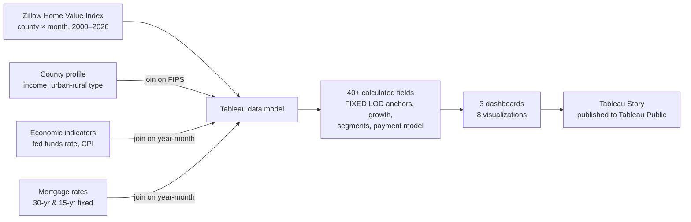
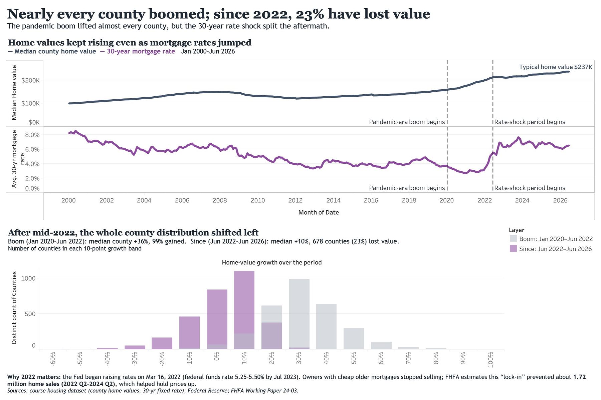
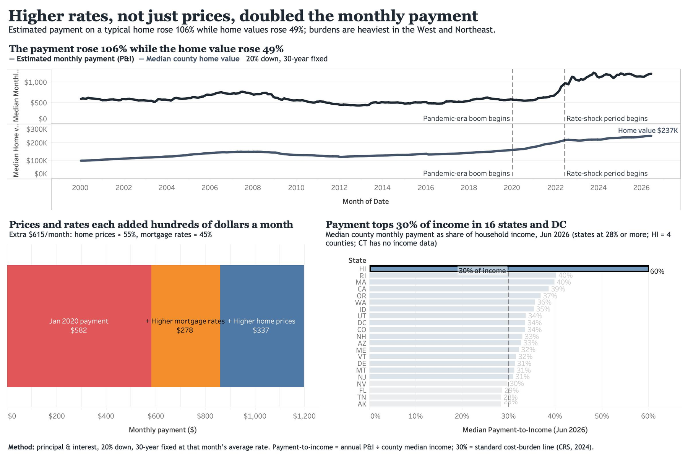
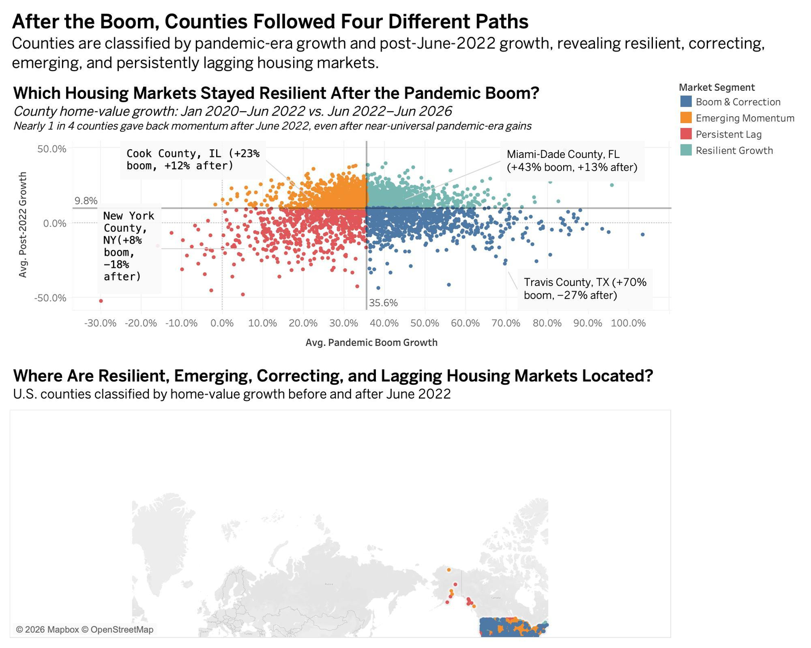
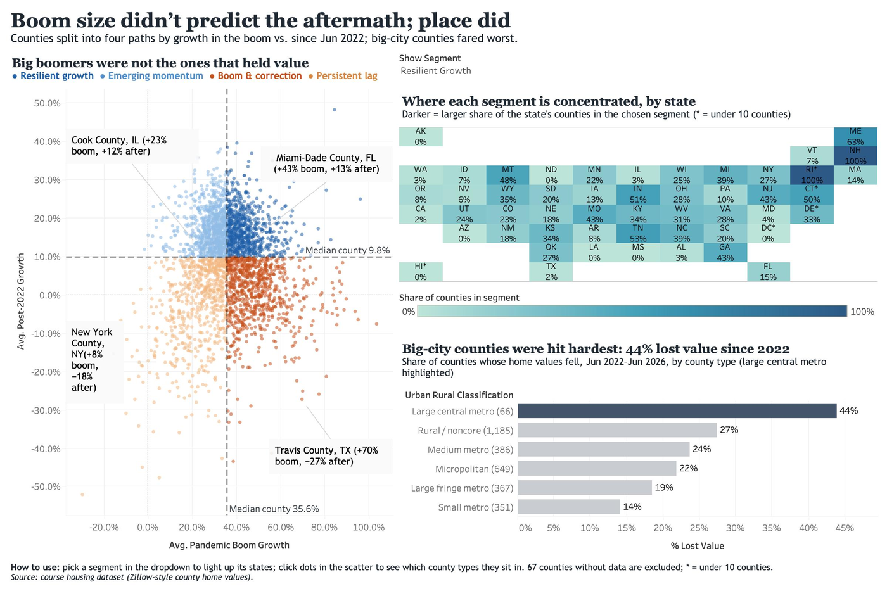

<p align="center"></p>

<p align="center">
  <b>A Tableau story on 26 years of U.S. county home values: who gained in the boom, who lost value after the 2022 rate shock, and how much harder it got to buy a home.</b>
</p>

<p align="center">
  <a href="https://public.tableau.com/app/profile/hrishad.amre/viz/HrishadAmre-DataVisualization/Story1"></a>
  <a href="reports/project-reflection.pdf"></a>
  <a href="docs/methodology.md"></a>
</p>

<p align="center">
  
  
  
  
  
</p>

<br>

<table align="center">
<tr>
<td align="center" width="25%"><h2>3,004</h2><sub>U.S. counties analyzed</sub></td>
<td align="center" width="25%"><h2>23%</h2><sub>of counties lost value after Jun 2022</sub></td>
<td align="center" width="25%"><h2>+106%</h2><sub>rise in monthly payment vs. +49% in home value</sub></td>
<td align="center" width="25%"><h2>16 + DC</h2><sub>states where the payment tops 30% of income</sub></td>
</tr>
</table>

<br>

## The Business Question

Between 2020 and 2022, U.S. home values rose almost everywhere. Then the Federal Reserve began raising rates (March 2022) and 30-year mortgage rates went from a **2.7% low to a 7.6% peak**. The national headline says prices "held up," but that average hides very different local outcomes.

> [!NOTE]
> **Who this is for:** home buyers judging affordability, sellers and agents reading local momentum, lenders and investors deciding which markets to target, and policymakers tracking cost burden. The story answers three questions in order: **what changed → where outcomes differed → what it costs a buyer.**

<br>

## Data Pipeline & Approach



<table>
<tr><th align="left">Step</th><th align="left">What I did</th></tr>
<tr><td><b>Frame</b></td><td>Defined two comparison windows: the <b>boom</b> (Jan 2020 → Jun 2022) and the <b>aftermath</b> (Jun 2022 → Jun 2026), split at the start of the rate shock.</td></tr>
<tr><td><b>Prepare</b></td><td>Joined four sources on FIPS and year-month, fixed two-digit years in the rate files, and added a null check after finding that 67 counties without values were being silently mislabeled.</td></tr>
<tr><td><b>Model</b></td><td>Used <code>FIXED</code> LOD expressions to pin each county's anchor values, then classified counties into four market segments by median boom and post-2022 growth.</td></tr>
<tr><td><b>Estimate</b></td><td>Built a principal-and-interest payment model (20% down, 30-year fixed at each month's rate) and split the payment increase into a price effect and a rate effect.</td></tr>
<tr><td><b>Enrich</b></td><td>Added outside context: Fed rate-hike timing, FHFA's mortgage lock-in estimate (≈1.72M fewer home sales), and the 30%-of-income cost-burden line from the Congressional Research Service.</td></tr>
<tr><td><b>Communicate</b></td><td>Wrote takeaway titles, used direct labels and a color-blind-safe palette, and audited every view against the course's Baseline Visualization Standards.</td></tr>
</table>

<br>

## The Story in Three Dashboards

### 1 · The boom was broad
**Nearly every county boomed; since 2022, 23% have lost value.** A dual-axis timeline lines up home values against mortgage rates, and overlaid histograms show the whole county distribution shifting left after mid-2022.

<p align="center"></p>

### 2 · The aftermath wasn't
**Boom size didn't predict the aftermath; place did.** A quadrant scatter sorts 3,004 counties into four paths. A parameter-driven tile map shows where each path is concentrated, and selecting points in the scatter filters a bar chart by county type.

<p align="center"></p>

### 3 · Rates made buying harder
**Higher rates, not just prices, doubled the monthly payment.** The estimated payment is tracked against home value, the $615/month increase is broken into its two drivers, and states are ranked by payment-to-income.

<p align="center"></p>

<br>

## Key Insights

<table>
<tr><th align="left">Finding</th><th align="left">Evidence</th><th align="left">Why it matters</th></tr>
<tr><td><b>The boom lifted almost everyone</b></td><td>Median county <b>+36%</b> (Jan 2020–Jun 2022); <b>99%</b> of counties gained</td><td>Pandemic gains were a national event, not a local one</td></tr>
<tr><td><b>The aftermath split markets</b></td><td>Median county only <b>+10%</b> since Jun 2022; <b>678 counties (23%)</b> lost value</td><td>National averages hide real local losses</td></tr>
<tr><td><b>Big boomers didn't hold value</b></td><td>Travis County, TX: <b>+70%</b> boom, <b>−27%</b> after. Miami-Dade, FL: +43%, then +13%</td><td>Past growth is a weak signal for picking markets</td></tr>
<tr><td><b>Big cities fared worst</b></td><td><b>44%</b> of large central metro counties lost value, vs. 14% of small metros</td><td>Urban markets carried the most downside risk</td></tr>
<tr><td><b>Rates drove nearly half the cost shock</b></td><td>Payment <b>$582 → $1,197</b> (+106%) while values rose 49%; ≈<b>55%</b> of the increase from prices, ≈<b>45%</b> from rates</td><td>Affordability can't be judged from price alone</td></tr>
<tr><td><b>Cost burden is regional</b></td><td>Payment tops <b>30% of median income</b> in 16 states + DC; Hawaii reaches <b>60%</b></td><td>The West and Northeast are where buyers feel the most pressure</td></tr>
</table>

> [!IMPORTANT]
> **On correlation and causation:** home values held up while rates rose. The dashboards present rates as context, not as a single cause. Constrained supply from rate lock-in (FHFA) is shown as one contributing explanation.

<br>

## Techniques Used

<table>
<tr>
<td width="50%" valign="top">

**Calculations**
- `FIXED` LOD expressions for county anchor values and medians
- Conditional segmentation logic with explicit null handling
- Amortization formula for estimated monthly P&I
- Price vs. rate decomposition, averaged across both orderings

</td>
<td width="50%" valign="top">

**Design & interactivity**
- Parameter-driven tile map built from a hand-coded state grid
- Filter action from scatter selection to county-type bars
- Overlaid histograms to compare two distributions directly
- Takeaway titles, direct labels, color-blind-safe palette

</td>
</tr>
</table>

<br>

## Iteration: Draft → Final

<table>
<tr>
<td align="center" width="50%"><br><sub><b>Draft:</b> question title, default colors, separate legend, filled map that buries small Eastern states</sub></td>
<td align="center" width="50%"><br><sub><b>Final:</b> takeaway title, color-blind-safe palette, subtitle as legend, equal-area tile map, linked bar chart</sub></td>
</tr>
</table>

The redesign came from professor and peer-review feedback combined with an audit against the BUDT 705 Baseline Visualization Standards. The full reasoning is in the [project reflection](reports/project-reflection.pdf) and the [chart redesign write-up](reports/chart-redesign-before-after.pdf).

<br>

## Repository Structure

```
pandemic-housing-boom-tableau-analysis/
├── README.md
├── tableau/                 # Tableau workbook (.twbx packaged / .twb)
├── data/
│   ├── README.md            # Sources, data dictionary, how to get the main table
│   └── raw/                 # Supplemental CSVs (county profile, economic, mortgage rates)
├── assets/
│   ├── dashboards/          # Final dashboard screenshots
│   └── iteration/           # Draft vs. final comparisons
├── docs/
│   └── methodology.md       # Calculated fields, segment logic, payment model
└── reports/                 # Project reflection and chart-redesign write-up
```

<br>

## How to Explore

<table>
<tr><td><b>Fastest</b></td><td>Open the <a href="https://public.tableau.com/app/profile/hrishad.amre/viz/HrishadAmre-DataVisualization/Story1">live story on Tableau Public</a>. No install needed.</td></tr>
<tr><td><b>In Tableau</b></td><td>Open the workbook in <code>tableau/</code> with Tableau Desktop or Tableau Public (free). The packaged <code>.twbx</code> includes its data. To use the <code>.twb</code>, add the main county table to <code>data/raw/</code> first (see <a href="data/README.md">data/README.md</a>).</td></tr>
<tr><td><b>Interact</b></td><td>On Dashboard 2, pick a segment from <i>Show Segment</i> to recolor the tile map, then select dots in the scatter to filter the county-type chart.</td></tr>
</table>

<br>

## Sources

- Course dataset: Zillow Home Value Index (ZHVI) by county and month, Jan 2000–Jul 2026, with county, economic, and mortgage-rate supplements (BUDT 705, University of Maryland)
- Federal Reserve: federal funds rate target history (hikes began March 16, 2022)
- Federal Housing Finance Agency: Working Paper 24-03, mortgage rate lock-in
- Congressional Research Service (2024): housing cost burden, 30%-of-income threshold

<br>

---

<p align="center">
  <b>Hrishad Amre</b><br>
  <sub>M.S. Information Systems & AI · Robert H. Smith School of Business, University of Maryland</sub><br>
  <sub>Data Visualization for Business (BUDT 705) · Prof. Jessica M. Clark · Fall 2026</sub>
</p>

<p align="center">
  <a href="https://www.linkedin.com/in/hrishadamre/"></a>
  <a href="mailto:hrishad@umd.edu"></a>
  <a href="https://github.com/hrishadamre"></a>
  <a href="https://public.tableau.com/app/profile/hrishad.amre"></a>
</p>
